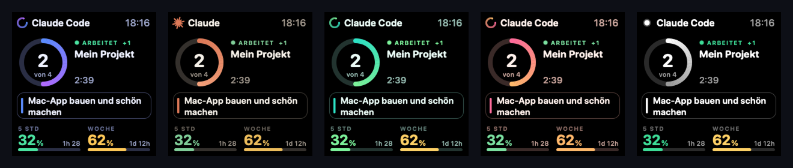

# Claude Display

**Ein kleines Schreibtisch-Display für Claude Code.** Zeigt live, woran Claude gerade arbeitet – mit Fortschritt, aktuellem Schritt und deinem Nutzungslimit – auf einem günstigen [GeekMagic SmallTV-Ultra](https://github.com/GeekMagicClock/smalltv-ultra) (ESP8266, 240 × 240 px).

*A tiny desk display for Claude Code: live session progress and your usage limit on a GeekMagic SmallTV-Ultra. Apps for macOS and Windows, custom firmware, setup wizard, OTA updates. (UI in German.)*



## Funktionen

- **Live-Sitzung** – Name, Laufzeit, Fortschrittsring und der aktuelle Schritt der gerade arbeitenden Claude-Code-Sitzung – aus der Desktop-App, dem Terminal und auch aus **Cloud-Sitzungen** (Claude Code im Browser)
- **Wartet auf dich** – fragt Claude etwas oder braucht eine Freigabe, färbt sich das Display und zeigt es an
- **Mehrere Sitzungen** – das Display wechselt zwischen allen, die gerade arbeiten
- **Nutzungslimit** – 5-Stunden- und Wochenlimit mit Zeit bis zum Reset, etwa jede Minute aktualisiert; ab 90 % eine deutliche Warnung, in der App ein Verlauf über 24 Stunden oder 7 Tage
- **Eigene Uhr** – läuft kein Rechner, zeigt das Display Uhrzeit und Datum (Zeit per NTP)
- **Mac und PC gleichzeitig** – der Rechner mit aktiver Sitzung bekommt das Display
- **Einrichtungs-Assistent** – findet das Display im WLAN, spielt bei neuen Geräten die Firmware auf, verbindet dein Claude-Konto
- **Frei gestaltbar** – Vorlagen (Neon, Claude, Aurora, Sunset, Mono) oder eigene Farben, Logo und Titel – getrennt für App und Display
- **Layout-Editor** – jedes Element auf dem Display frei verschieben, in der Größe ändern, ausblenden oder eigene Texte und Linien hinzufügen; mit Vorlagen (Standard, Fokus, Limits groß, Groß), Hilfslinien und Rückgängig
- **Menüleiste oder Fenster** – unauffällig in der Menüleiste/im Infobereich oder als App mit Dashboard
- **Schriftgröße** – die ganze App in vier Stufen von „Klein“ bis „Sehr groß“
- **Stabile Übertragung** – sofortiges Neuverbinden nach Abbrüchen, regelmäßige Vollbilder zur Selbstkorrektur, die Firmware räumt tote Verbindungen auf und überwacht das WLAN
- **Updates über GitHub** – App und Display-Firmware lassen sich direkt in der App aktualisieren
- **Nachtmodus** – dimmt automatisch, auch wenn kein Rechner läuft

## Was du brauchst

- einen **GeekMagic SmallTV-Ultra** (die ESP8266-Version, *nicht* „Pro“)
- **macOS 14** oder neuer bzw. **Windows 10/11**
- ein **Claude-Konto** (Pro oder Max) – die App installiert bei Bedarf die offizielle Claude-Code-CLI und meldet dich darüber an

## Installation

Lade die neueste Version unter [**Releases**](../../releases/latest):

| System | Datei |
|---|---|
| macOS | `ClaudeDisplay-mac.pkg` – Installer, danach startet der Assistent |
| Windows | `ClaudeDisplay.exe` – einfach starten, keine Installation nötig |

Die Dateien sind nicht signiert. macOS: Rechtsklick → *Öffnen*. Windows: *Weitere Informationen* → *Trotzdem ausführen*.

Beim ersten Start führt dich der Assistent durch alles:

1. **Claude verbinden** – installiert bei Bedarf Claude Code und öffnet die Anmeldung im Browser
2. **Display finden** – sucht im WLAN (`claude-display.local` und das eigene Netz) oder per IP
3. **Firmware aufspielen** – nur bei einem neuen SmallTV-Ultra, per WLAN
4. **WLAN einrichten** – das Display öffnet das WLAN „Claude-Display-Setup“, dort trägst du einmal dein WLAN ein
5. **Look und App-Modus wählen**

## Wichtige Hinweise

- **Inoffizielles Projekt.** Nicht von Anthropic. „Claude“ ist eine Marke von Anthropic.
- **Nutzungslimit und Cloud-Sitzungen:** Die App liest beides über den lokalen Login der Claude-Code-CLI und nicht offiziell dokumentierte Schnittstellen. Sie können sich jederzeit ändern; dann fehlt nur die jeweilige Anzeige. Cloud-Sitzungen lassen sich in den Einstellungen abschalten.
- **Firmware:** Das Aufspielen ersetzt die Original-Firmware (Wetter, Fotos). Zurück zur Original-Firmware kann GeekMagic einen Aktivierungscode verlangen. Der USB-Anschluss liefert nur Strom – startet eine Firmware gar nicht, hilft nur ein serieller Adapter.
- **Datenschutz:** Alles läuft lokal. Die App spricht nur mit deinem Display im WLAN, mit Anthropic (Limit, Login, Cloud-Sitzungen) und mit GitHub (Updates). Keine Telemetrie.

## Wie es funktioniert

```
Claude Code ──► ~/.claude/sessions + Protokolle ──┐
Anthropic-API (Limit) ────────────────────────────┤
                                                  ▼
                               Claude Display (Mac/Windows)
                               zeichnet 240×240 und schickt nur
                               geänderte Pixel per TCP (Port 7777)
                                                  ▼
                               SmallTV-Ultra mit eigener Firmware
                               (HTTP: Status, Helligkeit, Theme, OTA)
```

## Projektaufbau

| Ordner | Inhalt |
|---|---|
| `mac/` | SwiftUI-App (Menüleiste/Fenster, Assistent, Updates) |
| `windows/` | Avalonia/.NET-App (läuft zum Testen auch auf macOS) |
| `firmware/` | PlatformIO-Firmware für den ESP8266 + Generator für Schriften |
| `scripts/` | Release-Skript |

## Selbst bauen

```bash
# Firmware (PlatformIO)
cd firmware && pio run -e display

# macOS-App (Xcode 15+); ./make_installer.sh baut zusätzlich das .pkg
cd mac && ./build.sh --no-install

# Windows-App (.NET 8)
cd windows && dotnet publish -c Release -r win-x64 -o publish

# Alles lokal bauen und als GitHub-Release veröffentlichen
./scripts/release.sh 1.0.0
```

Releases baut auch **GitHub Actions** (`.github/workflows/build.yml`): Ein Tag wie `v1.4.0` pushen – Firmware, macOS-Installer und Windows-App werden auf sauberen Rechnern gebaut, geprüft (die Windows-App wird dabei auf echtem Windows gestartet) und veröffentlicht. Den Release-Text liest der Workflow aus `.github/release-notes/v1.4.0.md`.

## Lizenz

[MIT](LICENSE)
